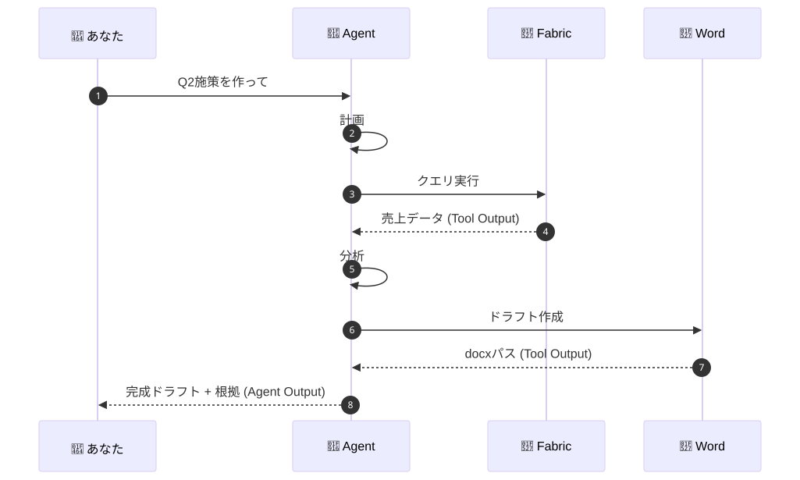

# AIエージェント教科書 🤖
**MCP / Skills / Output / Agent ── 1ページで腹落ちするための短い解説書**

---

## 0. このページの読み方

- **太字の一文 = 結論**
- 図 = 言葉より速く伝わる
- たとえ = 1行だけ

---

## 1. AIエージェントとは

> **「目的を渡すと、自分で道具を選んで最後までやってくれる AI」**

ChatGPT が「答える人」なら、エージェントは「**やってくれる人**」。

🍳 **一行のたとえ：レストランで「注文」を受けたら、買い出し・調理・盛り付けまで全部やる料理人。**

  
  <figcaption>図1: 登場人物の関係（あなた → Agent → 道具 → Output）</figcaption>

---

## 2. 5つの役者を1行ずつ

| 用語 | 一行で言うと |
|---|---|
| **Agent** | 考えて動く本体（料理人） |
| **Tool** | 1回の操作（包丁・コンロ） |
| **MCP** | ツールに繋ぐ共通プラグ（コンセント規格） |
| **Skill** | 特定料理のレシピ集 |
| **Output** | 最終的に出てくる成果物（皿） |

---

## 3. Agent の中身 ── ぐるぐる回るだけ

> **エージェントは「計画 → 実行 → 確認 → やり直し」のループを回しているだけ。**

  
  <figcaption>図2: ReAct ループ ── 完了するまで回り続ける</figcaption>

🔁 **一行のたとえ：レシピを見ながら味見して、足りなければ塩を足す、それだけ。**

### ChatGPT との違い

| | ChatGPT | エージェント |
|---|---|---|
| 入力 | 質問 | **目的** |
| 動作 | 一発回答 | **複数ステップ** |
| 副作用 | なし | **あり**（ファイル作成、メール送信等） |
| 失敗 | そのまま | **自己修正** |

---

## 4. MCP ── 「USB-C」と覚える

> **MCP = AIエージェントと外部ツールを繋ぐ業界標準プロトコル。**

🔌 **一行のたとえ：USB-C。これ一本で、どの機械にも繋がる。**

### なぜ必要か

  
  <figcaption>図3: MCP以前 ── エージェント数×ツール数だけ個別接続が必要</figcaption>

  
  <figcaption>図4: MCP以後 ── ツールごとに MCPサーバを1つ立てれば、どのエージェントからも繋がる</figcaption>

**業務での意味**：Fabric を MCP で公開すれば、Copilot からも Claude からも社内独自エージェントからも、**同じ作法で**繋がる。Ontology 戦略の入口になる。

---

## 5. Skills ── 「マニュアル」と覚える

> **Skill = エージェントに「特定の仕事の進め方」を教えるパッケージ。**

📘 **一行のたとえ：新人に渡す「この案件の進め方マニュアル」。**

### MCP との違いだけ覚えれば OK

  
  <figcaption>図5: MCP は「道路」、Skill は「運転マニュアル」── 両方そろって動く</figcaption>

| | MCP | Skill |
|---|---|---|
| 何 | 接続規格 | 使い方の知識 |
| 例 | Fabric への口 | ブランド審査の手順 |
| 作る人 | IT・ISV | 業務の専門家 |

---

## 6. Tool と Output ── 混同注意

> **Tool Output = 途中の生データ。Agent Output = 最終成果物。**

  
  <figcaption>図6: 1回1回のツール結果（Tool Output）を集めて、エージェントが最終成果物（Agent Output）に仕上げる</figcaption>

---

## 7. これまでと何が違うのか

  
  <figcaption>図7: キーワード → 質問 → 目的、と人間の入力が抽象化していく</figcaption>

> **副作用を起こす AI なので、ガバナンス（権限・承認・監査）が必須になった。**

⚠️ **一行のたとえ：包丁を渡した新人を野放しにしない。誰が何をしたかログを取る。**

---

## 8. 業務での使いどころ（Biore の例だけ1枚）

  
  <figcaption>図8: クリエイティブ案を Brand Guardian Agent が査定 → 人間が最終承認</figcaption>

> **エージェントが「下書きと根拠」を出し、人間が「最終承認」をする。これが基本形。**

---

## 9. 用語チートシート

| 用語 | 30秒説明 |
|---|---|
| Agent | 目的を受けて自律的に動く AI |
| LLM | エージェントの思考エンジン（GPT, Claude） |
| Tool | エージェントが呼ぶ1つの操作 |
| MCP | エージェント↔ツールの標準プロトコル |
| MCP Server | ツール側を MCP で公開する小さなサーバ |
| Skill | ドメイン手順をまとめた再利用パッケージ |
| Context | 参照する背景情報 |
| Memory | エージェントの記憶 |
| Output | 最終成果物 |
| ReAct | 計画→実行→観察 のループ |
| HITL | 人間の承認を挟む設計 |
| Guardrail | 逸脱を防ぐ制約 |
| Grounding | 実データに根拠づけること |

---

## 10. 明日からの一歩

1. Copilot CLI で `/help` → 使える MCP / Skill が見える
2. MCP サーバを 1 つ追加（GitHub MCP がおすすめ）
3. `SKILL.md` を 1 ファイル書いて自分用 Skill を作る

---

  <em>📚 okatech さん専用パーソナライズ版 / Generated with GitHub Copilot CLI × WorkIQ</em>

