# AIエージェント教科書 🤖
## MCP / Skills / Output / Agent —— okatech さん（Microsoft RCG Industry Advisor）向け

> **この教科書のゴール**
> GitHub Copilot CLI や VS Code で「誰かが作ったエージェント」を使っているとき、画面に飛び交う **MCP / Skills / Output / Agent / Tool** といった用語を、たとえ話と図で「腹落ち」させること。
> たとえ話はあなたの普段の業務（**Kao Biore グローバルブランディング / Agentic Marketing & Commerce / Microsoft Fabric × Work IQ**）に寄せています。

---

## 📖 目次

1. [そもそも「AIエージェント」とは](#1-そもそもaiエージェントとは)
2. [全体像 ── 3分で頭に入れる「役者」たち](#2-全体像--3分で頭に入れる役者たち)
3. [Agent（エージェント）── “考えて動く” 主役](#3-agentエージェント-考えて動く-主役)
4. [Tool（ツール）と Output（出力）── “手と成果物”](#4-toolツールと-output出力-手と成果物)
5. [MCP（Model Context Protocol）── “世界中のツールに繋がるUSB-C”](#5-mcpmodel-context-protocol-世界中のツールに繋がるusb-c)
6. [Skills（スキル）── “専門家のマニュアル”](#6-skillsスキル-専門家のマニュアル)
7. [これまでと何が違うのか](#7-これまでと何が違うのか)
8. [あなたの業務での使いどころ](#8-あなたの業務での使いどころ)
9. [用語集（チートシート）](#9-用語集チートシート)

---

## 1. そもそも「AIエージェント」とは

### 一言で言うと

<div class="callout callout-blue" markdown="1">
**AIエージェント = 「目的を渡すと、自分で道具を選び、手順を考え、最後まで仕事をやり遂げようとする AI」**
</div>

これまでの ChatGPT 的な使い方は **「質問 → 回答」の一往復**。
AIエージェントは **「目的 → ツールを使って調べる → 考える → 別のツールで実行 → 検証 → 報告」** という **複数ステップ** を勝手に回します。

### 🎭 たとえ話：あなたの業務に置き換えると

> Biore のグローバルローンチで、博報堂・PwC・現地代理店と動いているとき、
> あなたが **「APAC 5カ国の Q2 マーケティング施策のドラフトを、ブランドガードレールに沿って作っておいて」** と言える「**優秀な若手コンサル**」がいるとします。
>
> その若手は、
> - Fabric から ID-POS と VoC を引っ張り（= ツールを使う）
> - ブランドガイドラインを暗記していて（= スキル）
> - 各国の規制 DB に問い合わせ（= 別のツール）
> - ドラフトを Word にまとめ、Teams に投げる（= Output）
> - **でも最終決裁は絶対にあなたから奪わない**
>
> **これがエージェントの正体**です。技術的には ChatGPT の進化形ですが、立ち位置は「**判断の質を底上げするために横にいる存在**」。

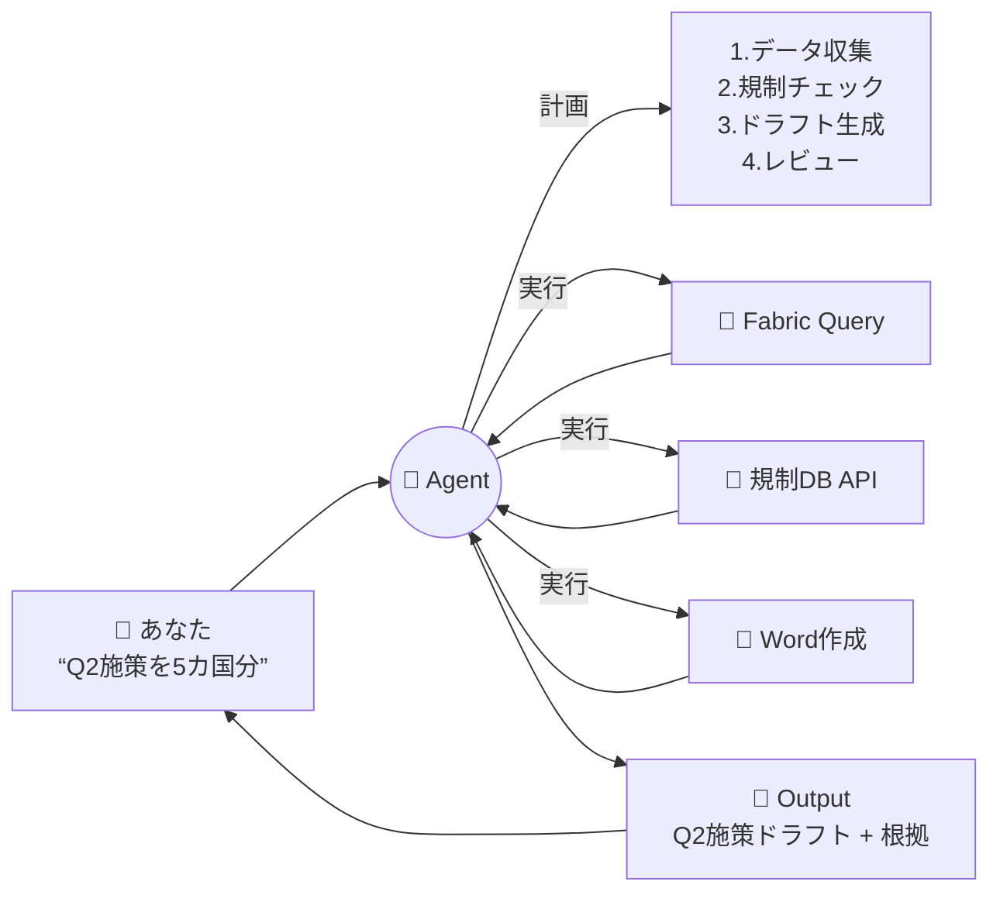

---

## 2. 全体像 ── 3分で頭に入れる「役者」たち

VS Code や Copilot CLI の画面で飛び交う言葉を、まず **登場人物表** で整理します。

| 用語 | あなたの会社で例えると | 役割 |
|---|---|---|
| **Agent** | 若手コンサル本人 | 目的を受け取り、考えて、最後まで仕事を回す |
| **Tool** | Excel・Fabric・Outlook などの「道具」 | 1回の操作（DB検索、メール送信、ファイル作成） |
| **MCP** | 社内ツールの「共通コンセント規格」 | エージェントが外部ツールに繋がる**標準プロトコル** |
| **Skill** | 「Biore ブランド対応マニュアル」 | エージェントに**特定ドメインの作法**を教えるパッケージ |
| **Output** | 提出される PPT / Word / メール | エージェントが最終的に出す**成果物** |
| **Context** | 案件背景・過去議事録 | エージェントが**判断材料として読む情報** |

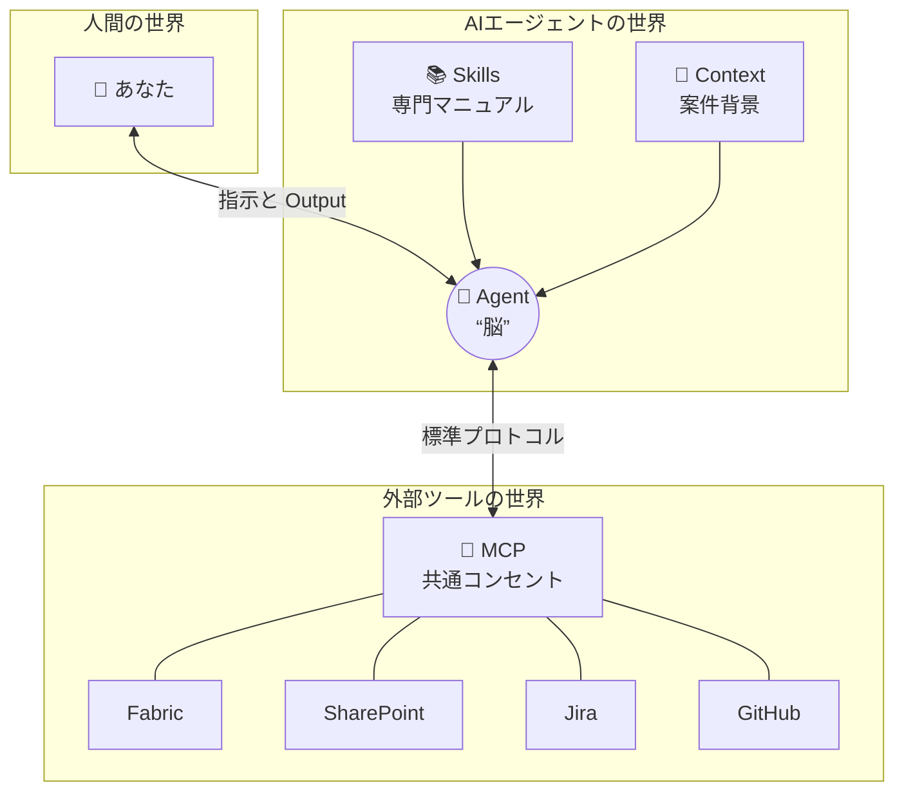

---

## 3. Agent（エージェント）── “考えて動く” 主役

### 技術的には

エージェントは内部で **「Plan → Act → Observe → Reflect」** のループを回しています（ReActパターンと呼ばれます）。

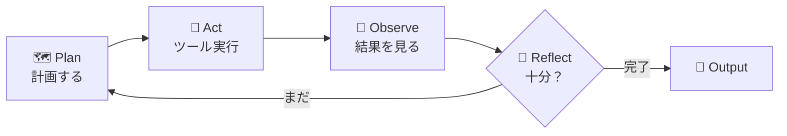

LLM（GPT-4 や Claude など）はこのループの「**思考担当**」です。エージェントフレームワーク（Copilot Studio、LangChain、Semantic Kernel など）が「**手足と司令塔**」を提供します。

### ChatGPT との違い

| | ChatGPT（従来） | AIエージェント |
|---|---|---|
| 入力 | 1つの質問 | 1つの**目的** |
| 動作 | 1回の応答 | **複数回**ツールを使い分け |
| 状態 | ステートレス | **記憶**を持つ（メモリ） |
| 結果 | テキスト | **副作用**あり（ファイル作成、API実行） |
| 失敗時 | そのまま回答 | **自己修正**する |

<div class="callout callout-purple" markdown="1">
💡 **あなたの言葉に翻訳**
「ツールの寄せ集め」ではなく「**マーケターの思考プロセスを横断的に引き受ける補助脳**」── これがまさに Agentic Marketing & Commerce で語っている世界観そのものです。
</div>

---

## 4. Tool（ツール）と Output（出力）── “手と成果物”

### Tool = エージェントの「指」

Tool は「**1回の単純な操作**」を表します。たとえば:

- `read_file(path)` — ファイルを1つ読む
- `web_search(query)` — Web検索する
- `query_fabric(sql)` — Fabric にクエリする
- `send_teams_message(channel, msg)` — Teams に投稿する

エージェントは「目的」から逆算して、**どのツールをどの順番で使うか**を自分で決めます。

### Output = 最終成果物 vs 途中の出力

VS Code の画面で「Output」と書いてある場所には **2種類** あります。混同しがちなので注意:

| 種類 | 意味 | 例 |
|---|---|---|
| **Tool Output**（途中） | 個々のツール実行の結果 | `query_fabric` が返した行データ |
| **Agent Output**（最終） | エージェントが「これが答え」と提出するもの | 「Q2施策ドラフト.docx」 |

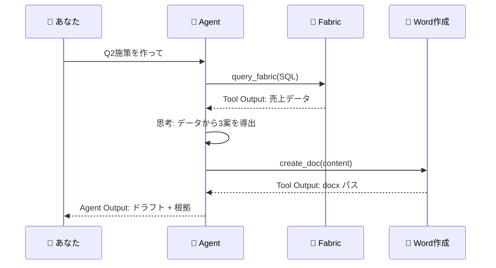

---

## 5. MCP（Model Context Protocol）── “世界中のツールに繋がるUSB-C”

### 一言で

<div class="callout callout-blue" markdown="1">
**MCP = AIエージェントと外部ツール（Fabric、Jira、GitHub、SharePoint…）を繋ぐ「業界標準の差込口」**
Anthropic が 2024 年末に提唱し、OpenAI / Microsoft / GitHub なども採用、**事実上の標準**になりつつあります。
</div>

### なぜ生まれたか ── “N×M 問題”

MCP がない世界では、

- エージェントが N 個（Copilot, Claude, Cursor, ChatGPT…）
- ツールが M 個（Fabric, Jira, SharePoint, GitHub, Slack…）

→ **N × M 個の個別連携**を作らないといけませんでした。

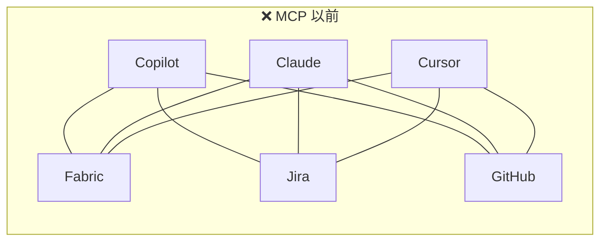

MCP 以後は、**ツール側が「MCPサーバー」を1つ用意**すれば、どのエージェントからでも繋がります。

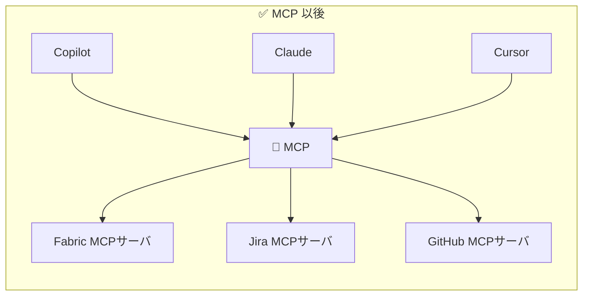

### 🔌 USB-C のたとえ

iPhone も Mac も Android も、昔は独自ケーブルでした。USB-C で**ケーブル1本**になった瞬間、周辺機器のエコシステムが爆発しました。
**MCP は AIエージェント界の USB-C** です。Fabric や Sitecore、Adobe などの ISV が MCP サーバーを出せば、あなたが使う Copilot CLI からも、お客様が使う Claude Desktop からも、**同じ繋ぎ方で**使えます。

### 技術的には

MCP は **JSON-RPC ベースの軽量プロトコル**で、サーバーは「使えるツール一覧」「リソース」「プロンプト」を公開します。

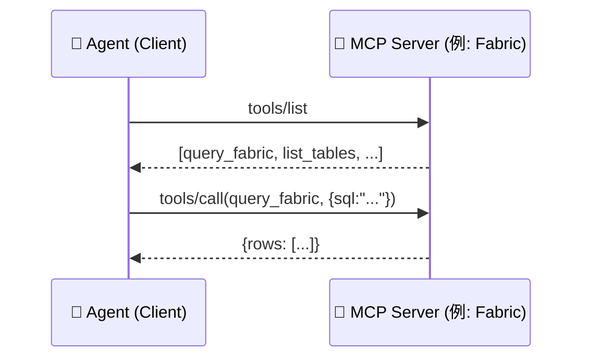

<div class="callout callout-green" markdown="1">
💡 **業務的インパクト**
「Fabric に MCP サーバーを立てる」=「Copilot, Claude, Cursor, さらには社内独自エージェントが、**全部同じ作法で**Fabric を使える」。
これは Ontology / Semantic Layer 戦略と直結します ── **AI-Ready Data の入口を MCP に統一**できる、という話です。
</div>

---

## 6. Skills（スキル）── “専門家のマニュアル”

### 一言で

<div class="callout callout-blue" markdown="1">
**Skill = エージェントに「特定ドメインの作法」を教える、再利用可能なパッケージ**
中身は「指示書（プロンプト） + ツール定義 + サンプル + 必要なら小さなコード」のセット。
</div>

### MCP との違い

ここが一番ややこしいので表で:

| | **MCP** | **Skills** |
|---|---|---|
| 役割 | **接続規格**（道路） | **使い方の知識**（運転マニュアル） |
| 提供するもの | ツールへのアクセス | ドメイン特化の手順・判断基準 |
| 例 | 「Fabricに繋がる口」 | 「Biore のブランドチェック手順」 |
| 誰が作る | ツール提供者（ISV、IT部門） | ドメイン専門家、コンサル |

### 🎓 たとえ話

- **MCP** は「**新人が会社のシステムにログインできる権限**」
- **Skill** は「**新人に渡される “Biore 案件 進め方マニュアル”**」

権限だけあっても、何をすべきか知らなければ動けません。マニュアルだけあっても、システムに繋がらなければ実行できません。**両方そろって初めてエージェントが戦力化**します。

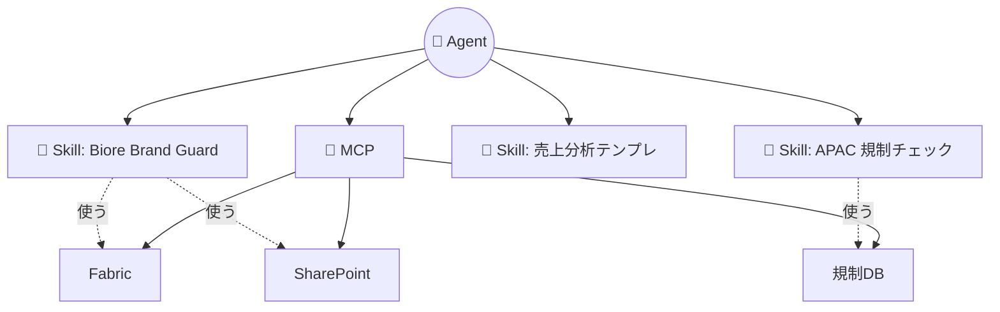

### Claude / Copilot の Skill 機能

最近の Claude（Anthropic Skills）や GitHub Copilot のスキル機能では、Skill は単純なフォルダ構造で:

```
my-skill/
  ├── SKILL.md       # 何ができるか・いつ使うかの説明
  ├── instructions/  # 詳細な手順書
  ├── scripts/       # 必要なら実行コード
  └── examples/      # サンプル入出力
```

エージェントは「**今の目的にこの Skill が役立ちそうだ**」と判断したら、自動でロードして使います。

---

## 7. これまでと何が違うのか

### 進化の3段階

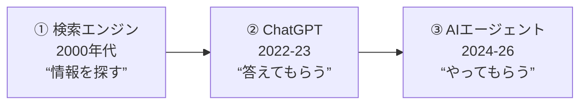

| | 検索エンジン | ChatGPT | AIエージェント |
|---|---|---|---|
| あなたが渡すもの | キーワード | 質問 | **目的** |
| AIが返すもの | リンク | 回答 | **完了した仕事** |
| 副作用 | なし | なし | **あり**（ファイル作成、メール送信、API実行） |
| 必要なガバナンス | 軽 | 中（ハルシネーション） | **重**（権限・監査・人間承認） |

### なぜ「ガバナンス」が重要になるのか

エージェントは **副作用を起こす**（実際にメールを送る、Jira を更新する、コードをコミットする）ため、

- **権限管理**（どのツールまで触ってよいか）
- **Human-in-the-Loop**（承認の差し込み）
- **監査ログ**（何をしたかの記録）

が必須になります。── これは NTTデータの AI ガバナンス文書や、あなたが Kao 案件で語っている「**ブランドを守りながら現場判断を補佐する**」という設計思想と完全に一致します。

<div class="callout" markdown="1">
⚠️ **エンタープライズで効く論点**
「Google の方が分かりやすい」という指摘は確かにあります。でも、エンタープライズでは **柔軟性 = 既存の業務プロセスへ嵌め込める力**。MCP / Skills という標準と、Copilot Studio / Fabric / Purview の組み合わせで、**“やってみた”で終わらせない設計**ができる ── これがあなたが語る Microsoft の差別化ポイントです。
</div>

---

## 8. あなたの業務での使いどころ

### 🌏 Kao Biore グローバルブランディング

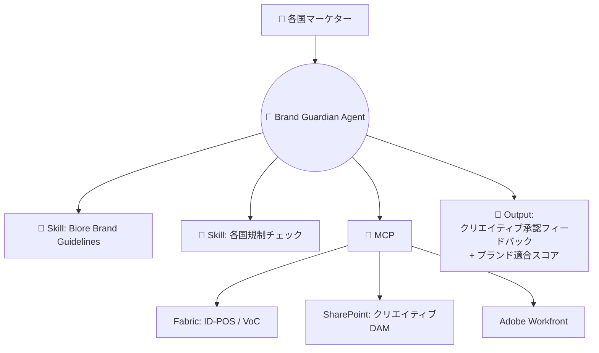

- **MCP** で各国の DAM / Workfront / Fabric に標準接続
- **Skill** に「Biore グローバル基準」「各リージョン基準」を分けて格納
- **Agent** が「現地版クリエイティブ案」をブランド観点で査定 → **最終決裁は人**

### 🛒 Agentic Marketing & Commerce（RCG）

調査 → 分析 → 企画 → クリエイティブ → 実行 を **分断しない** ── これは「複数の Skill を切り替えながら動く 1 体のエージェント」または「**マルチエージェント**（専門エージェントが連携）」で実装されます。

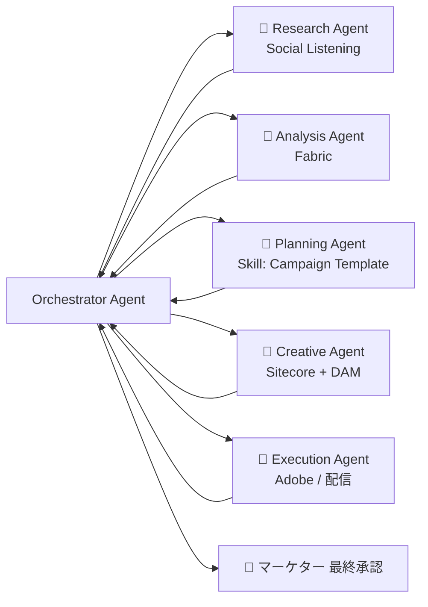

### 📊 Fabric × Work IQ

- Fabric の **Ontology / Semantic Layer** を MCP サーバーとして公開
- Work IQ が「組織の暗黙知（メール・会議）」側の MCP として並ぶ
- エージェントは **構造化データ（Fabric）** と **非構造化コンテキスト（Work IQ）** の両方を、**同じ作法で**参照できる

これが「**何を知っていて、何を知らないかが定義されているか**」というあなたの主張の技術的な裏付けです。

---

## 9. 用語集（チートシート）

| 用語 | 30秒説明 |
|---|---|
| **Agent** | 目的を受けて自律的に複数ステップを実行するAI |
| **LLM** | エージェントの「思考エンジン」（GPT-4, Claude等） |
| **Tool / Function** | エージェントが呼び出す1つの操作（API、関数） |
| **MCP** | エージェント↔ツールの業界標準プロトコル（USB-C） |
| **MCP Server** | ツールを MCP 経由で公開する小さなサーバー |
| **MCP Client** | MCP サーバーに繋ぐエージェント側 |
| **Skill** | ドメイン知識+手順をまとめた再利用可能パッケージ |
| **Context** | エージェントが参照する背景情報（履歴、ファイル等） |
| **Memory** | エージェントが保持する状態（短期・長期） |
| **Output** | エージェントの最終成果物（vs 途中のTool Output） |
| **ReAct** | Reason + Act の反復ループ（エージェントの基本パターン） |
| **Orchestrator** | 複数エージェントを統括する司令塔 |
| **HITL** | Human-in-the-Loop。人間の承認を挟む設計 |
| **Guardrail** | エージェントの逸脱を防ぐ制約（ブランド・倫理・権限） |
| **Grounding** | 回答を実データ（RAG等）に根拠づけること |
| **Agentic Workflow** | エージェントを組み込んだ業務プロセス全体 |

---

## 🎁 おまけ：明日から VS Code / Copilot CLI で試すこと

1. **Copilot CLI を起動して `/help` を打つ** → どんな Skill / MCP が有効か見える
2. **`@` でエージェントを呼ぶ**（VS Code Chat） → 誰かが作ったエージェントの一覧が出る
3. **MCP サーバーを 1 つ追加してみる**（例: GitHub MCP, Filesystem MCP）
4. **自分用 Skill を `SKILL.md` 1 ファイルで作る**（例: 「Biore 用語チェック」）

<div class="callout callout-green" markdown="1">
✨ **次の一歩のおすすめ**
このページの内容を、社内向けに **CxO 版 / マーケター版 / エンジニア版** の3つに「崩す」と、そのまま研修・営業資料になります。WorkIQ で雛形を作りましょう。
</div>

---

<p align="center">
  <em>📚 この教科書は okatech さん専用にパーソナライズされています。<br/>
  Generated with GitHub Copilot CLI × WorkIQ × Claude Opus 4.7</em>
</p>
